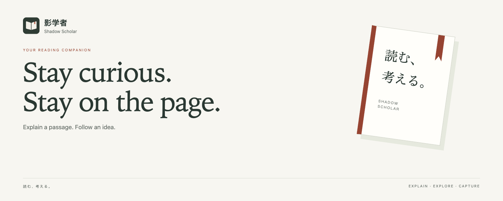
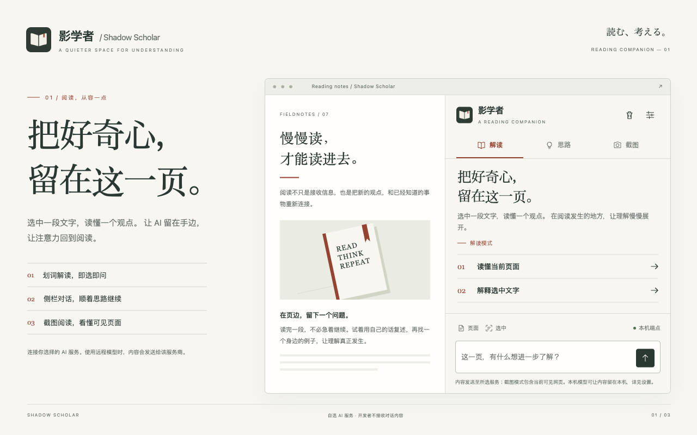
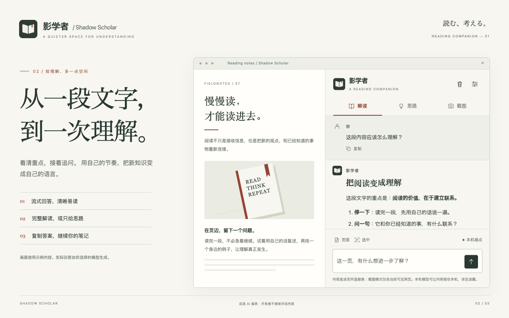
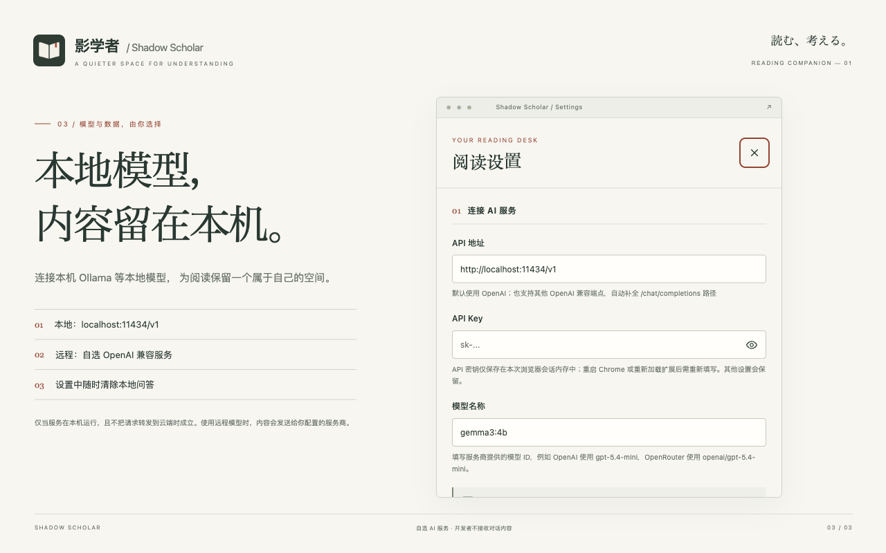
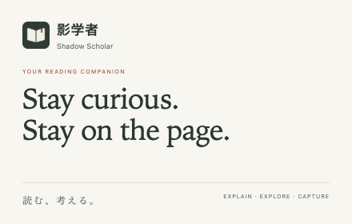

<p align="center">
  
</p>
<h1 align="center">影学者 · Shadow Scholar</h1>
<p align="center"><strong>把好奇心，留在这一页。</strong><br>Stay curious. Stay on the page.</p>
<p align="center">
  <a href="https://chromewebstore.google.com/detail/fjokopekhdlkbdaegfjnphiocpmiaimj">Chrome Web Store</a> ·
  <a href="docs/REVIEW_GUIDE.md">Review guide</a> ·
  <a href="PRIVACY.md">Privacy</a> ·
  <a href="LICENSE">MIT License</a> ·
  <a href="https://github.com/MeiTetsuH/shadow-scholar/issues">Support</a> ·
  <a href="docs/README.en.md">English</a>
</p>

影学者是一款 Chrome 阅读与学习助手。选中一段文字，读懂一个观点，再在侧栏里继续追问。你选择 AI 模型，它把解释放在阅读发生的地方。

纸白的底色、墨色的文字、克制的朱红标记。界面借鉴日系书刊与文具的排版，让正文、操作和数据说明各有位置。

<p align="center"><strong>Chrome 116+ · Manifest V3 · 中文 / English · 自选云端或本机模型</strong></p>

## 先了解它

| 安装与使用 | 公开说明与审核资料 |
| --- | --- |
| [Chrome Web Store](https://chromewebstore.google.com/detail/fjokopekhdlkbdaegfjnphiocpmiaimj) | [隐私政策：数据、接收方与保留时间](PRIVACY.md) |
| [开始使用](#开始使用) · [本地保存与清除](#本地保存与清除) | [审核指南：权限用途与可复现测试](docs/REVIEW_GUIDE.md) |
| [问题反馈](https://github.com/MeiTetsuH/shadow-scholar/issues) | [MIT 许可证](LICENSE) · [第三方声明](THIRD_PARTY_NOTICES.md) |

源码、截图与文档对应 **1.3.0**。商店版本以实际页面为准；提交审核不等于已获批准。图片中的阅读文章与 AI 回答为演示内容，实际结果由你配置的模型生成。

## 从阅读，到理解



| 你想做什么 | 怎么开始 |
| --- | --- |
| 读懂一个句子或概念 | 选中文字，点击浮动按钮；也可使用右键菜单 |
| 找到一页内容的重点 | 在侧栏点击「读懂当前页面」 |
| 顺着一个问题继续想 | 在侧栏追问，或切换到「思路」模式获得引导 |
| 理解图表或可见画面 | 切换「截图」，使用支持图像的模型 |

回答支持流式显示、Markdown、表格和代码复制。中英文界面均可使用；每种模式的提示词也可以自己修改。



## 模型与数据，由你选择

**使用本机 Ollama 等本地模型时，内容可以留在本机。** 条件是模型服务确实在这台电脑上运行，并且不把请求转发给云端服务。仅仅填写 `localhost` 并不能保证这一点，例如本地代理仍可能转发请求。

**使用远程 AI 服务时，请求内容会发送给该服务商。** 包括你主动发送的选中文字、页面摘要素材、消息、上下文，以及截图模式下当前可见的网页。服务商还会收到 API 密钥和连接信息，其自己的隐私与保留政策适用。

开发者没有后端，不会接收到你的密钥、对话、截图或回答。扩展没有广告与使用分析遥测。



## 开始使用

从 [Chrome Web Store](https://chromewebstore.google.com/detail/fjokopekhdlkbdaegfjnphiocpmiaimj) 安装，点击工具栏中的影学者图标，打开「阅读设置」。商店中的实际可用版本取决于审核进度；仓库中的设计版本为 **1.3.0**。

1. 填写 AI 服务的 API 地址、模型名称和需要的 API Key。
2. 阅读数据用途说明，确认同意后保存。更换地址需要重新同意。
3. 打开普通网页，选中文字，或者在侧栏开始提问。

| 使用方式 | API 地址示例 | 模型填写 |
| --- | --- | --- |
| 本机 Ollama | `http://localhost:11434/v1` | 本机已安装的模型名称 |
| OpenAI | `https://api.openai.com/v1` | 服务商支持的模型 ID |
| OpenRouter | `https://openrouter.ai/api/v1` | 完整模型 ID，包括提供商前缀 |
| 其他兼容服务 | 该服务的 OpenAI 兼容地址 | 服务商支持的模型 ID |

本机服务可以不填密钥；若服务限制来源，需要允许此扩展的来源。截图需要支持图像的模型。远程地址必须使用 HTTPS，HTTP 仅支持本机回环地址。基础地址会自动补全 `/chat/completions`；完整路径与查询参数保留。Ollama 的本机 `/api`、`/api/chat` 地址会转换为兼容接口。

扩展免费，不附带 AI 账号或额度；云服务可能收费。不直接支持原生 Anthropic Messages 接口。需要 Chrome 116 或更新版本；浏览器内部页面及部分商店页面限制扩展操作。

## 本地保存与清除

- **API 密钥**仅保存在浏览器会话内存，重启、重新加载或更新扩展后需重新填写。
- **设置和提示词**保存在本机。内联问答最多保留 50 条，待同步记录最多 100 条，另有总大小限制。
- **侧栏对话**保存在内存；清除对话会同时取消当前请求。
- **截图原图**不写入扩展历史，模型生成的文字解释可能作为答案保存。
- 在设置中选择「清除本地问答历史和待处理请求」即可删除这些记录。此操作无法删除服务商已收到的数据。

可选的「文字选择辅助」只处理编辑器外的复制、选择和右键菜单，不改写粘贴、焦点、可见性、计时器或脚本执行。完整的数据类别、接收方、保留时间和权限用途见 [隐私政策](PRIVACY.md)。

## 设计与商店素材

界面、图标与宣传图采用同一套纸白、墨绿和朱红配色。素材已保存在仓库中，便于查看与复现。

<details>
<summary>展开商店宣传图与全部截图</summary>

<p></p>

| 素材 | 尺寸 | 文件 |
| --- | --- | --- |
| 小型宣传图块 | 440 × 280 | [PNG](docs/images/promo-small.png) |
| 顶部宣传图块 | 1400 × 560 | [PNG](docs/images/promo-marquee.png) |
| 中文截图 | 1280 × 800 | [阅读](docs/images/store-zh-01.png) · [问答](docs/images/store-zh-02.png) · [本地模型](docs/images/store-zh-03.png) |
| English screenshots | 1280 × 800 | [Reading](docs/images/store-en-01.png) · [Conversation](docs/images/store-en-02.png) · [Local model](docs/images/store-en-03.png) |
| 图标 | 16 / 48 / 128 / 1024 | [商店图标](icons/icon128.png) · [源图](icons/icon1024.png) · [SVG](icons/logo.svg) |

商店截图与宣传图块均为无 alpha 透明层的 24 位 RGB PNG。设计说明、图标生成提示词和本机预览方法见 [设计目录](design/README.md)。

</details>

## 开发与验证

使用 Node.js 22+ 与 npm。安装依赖后，可在 `chrome://extensions` 中加载仓库目录作为未打包扩展。

```sh
npm ci --ignore-scripts
npm run verify
npm run package
```

`verify` 检查脚本、MV3 配置、翻译、打包依赖与行为测试。发布前还应在真实 Chrome 中验证。`package` 使用明确的文件清单生成 `dist/shadow-scholar-1.3.0.zip`，检查归档内容、CRC 和 SHA-256；测试、设计工具与开发依赖不进入安装包。

设计工作台：

```sh
npm run design
# http://localhost:11438/?slide=1&lang=zh
```

`slide=1/2/3` 与 `lang=zh/en` 对应六张商店画面。工作台直接加载扩展的 HTML、CSS 和脚本，使用合成内容与本机模拟响应，不调用第三方模型；它不替代真实扩展环境测试。画面以 1280 × 800 导出，浏览器缩放需为 100%。设计来源见 [design/README.md](design/README.md)。

| 文件 | 职责 |
| --- | --- |
| `background.js` / `stream.js` | 可信设置、会话密钥、请求路由、取消与流式解码 |
| `settings.js` / `extractors.js` | 端点校验、设置迁移与有界页面提取 |
| `sidepanel.*` / `content.js` | 侧栏、设置、页内浮窗 |
| `markdown.js` / `ui-icons.js` | 安全 Markdown 与随包提供的界面图标 |

## 开源许可与反馈

本仓库使用 [MIT License](LICENSE)。复制或再分发时请保留原许可证和著作权声明。随扩展分发的 Marked 保留其[完整许可证](lib/marked.LICENSE)，来源与版本见 [第三方声明](THIRD_PARTY_NOTICES.md)。AI 服务商的使用条款与生成内容不由本仓库许可证替代。

使用问题可通过 [GitHub Issues](https://github.com/MeiTetsuH/shadow-scholar/issues) 反馈，请注明扩展版本、Chrome 版本、操作步骤和错误信息。公开问题中请勿粘贴 API 密钥、个人通信或敏感网页内容。审核人员可直接参考 [Review guide](docs/REVIEW_GUIDE.md)。
