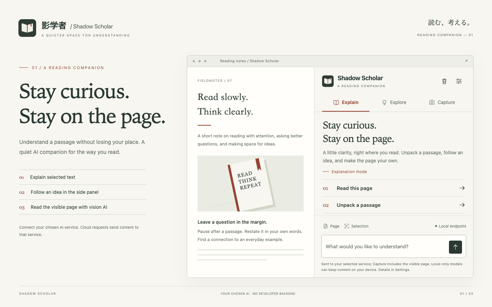
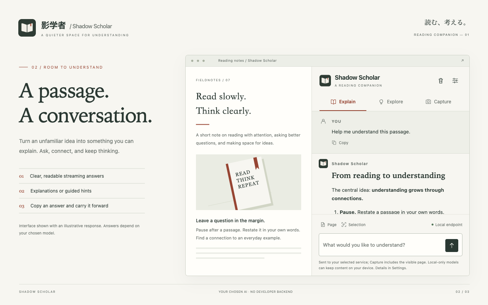
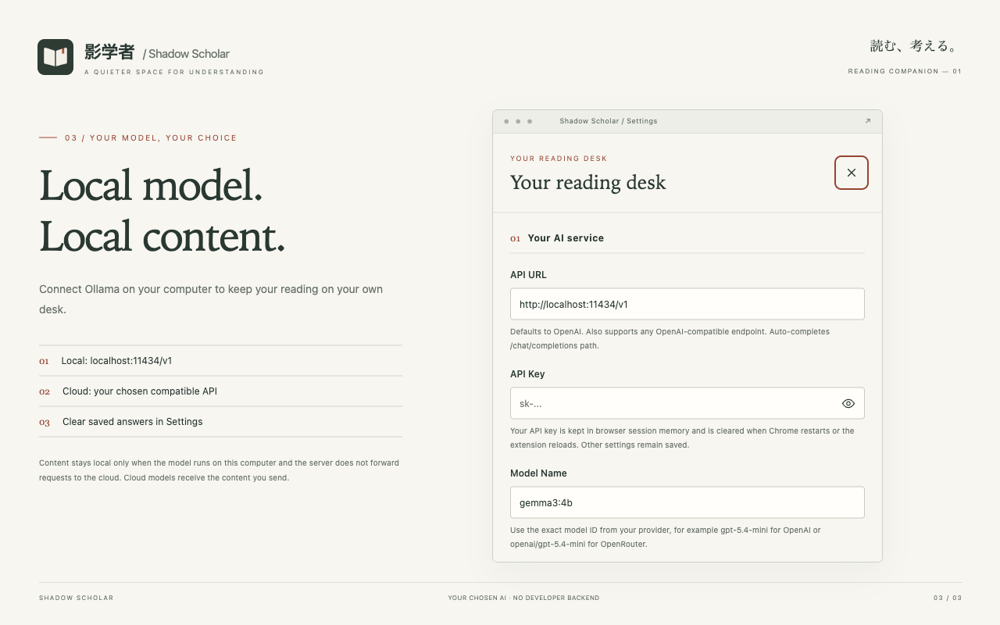

<h1 align="center">Shadow Scholar</h1>

Stay curious. Stay on the page. <a href="../README.md">中文</a> · <a href="https://chromewebstore.google.com/detail/fjokopekhdlkbdaegfjnphiocpmiaimj">Chrome Web Store</a> · <a href="../PRIVACY.md">Privacy</a>

A Chrome reading companion with a quiet, Japanese editorial-inspired interface. Select a passage, ask for an explanation, and keep a conversation beside the page. Bring your own OpenAI-compatible AI provider or a local model.

## Read, connect, understand

- Explain selected text through the floating action or context menu.
- Read the current page in a dedicated side panel.
- Switch between complete explanations, guided thinking, and visual reading.
- Get streaming Markdown, tables, code copying, and editable prompts.
- Choose English or Chinese. Keyboard controls, visible focus, and reduced-motion support are included.

## Your model, your choice

**Local models can keep content on your computer.** Connect a local Ollama model using `http://localhost:11434/v1`, enter the installed model name, and leave the key blank if your local service does not require it. This is local-only when the server runs on the same computer and does not forward requests to the cloud. A local proxy or cloud-backed model can still send data elsewhere. If your server restricts origins, allow the extension's origin.

**Cloud models receive the content you request.** Selected text, page excerpts, messages, context, custom prompts, and explicit visible-page screenshots go directly to your configured service. The provider also receives credentials and connection metadata. Its own retention and processing policies apply.

The developer operates no backend and receives none of that content. There is no advertising or usage telemetry.

## Get started

Install from the [Chrome Web Store](https://chromewebstore.google.com/detail/fjokopekhdlkbdaegfjnphiocpmiaimj), open the toolbar action, and choose Settings. Store availability depends on review; the source design release is **1.3.0**.

1. Enter your compatible API URL, model ID, and key if required.
2. Read and agree to the data disclosure, then save. A changed endpoint requires consent again.
3. Select text, read the page, or start a conversation. Capture mode requires a vision-capable model and sends a fresh visible-page screenshot with each request.

Remote endpoints require HTTPS; HTTP is restricted to loopback. Base URLs are completed with `/chat/completions`; complete paths and query parameters are preserved. Local Ollama `/api` and `/api/chat` inputs are converted to its compatible endpoint. Chrome 116+ is required. Browser-internal and some store pages restrict extensions. The extension supplies no AI account or credits; providers may charge for requests. Native Anthropic Messages endpoints are not supported.

## Storage & control

Keys live only in trusted browser session memory and must be entered again after restart, reload, or update. Preferences persist locally. Up to 50 inline answers and 100 pending transfers are stored locally, with additional size limits; remove them in Settings. Panel chat stays in memory. Clear Conversation also cancels its request. Screenshot images are not saved in extension history. Clearing local data cannot remove requests retained by your provider.

The optional selection helper preserves copy, selection, and context menus outside editors without changing paste, focus, visibility, timers, or script execution. See the complete [privacy policy](../PRIVACY.md).

## Development

Use Node.js 22+ and npm. Run `npm ci --ignore-scripts`, then `npm run verify` and `npm run package`. The package is built from a checked allowlist with CRC and SHA-256 verification. Load the repository as an unpacked extension for real Chrome tests.

`npm run design` serves the local visual workbench on port 11438. It uses the actual interface with synthetic fixture content and a local simulated response, makes no external model calls, and is excluded from the ZIP. See [design notes](../design/README.md). Code is [MIT licensed](../LICENSE).
